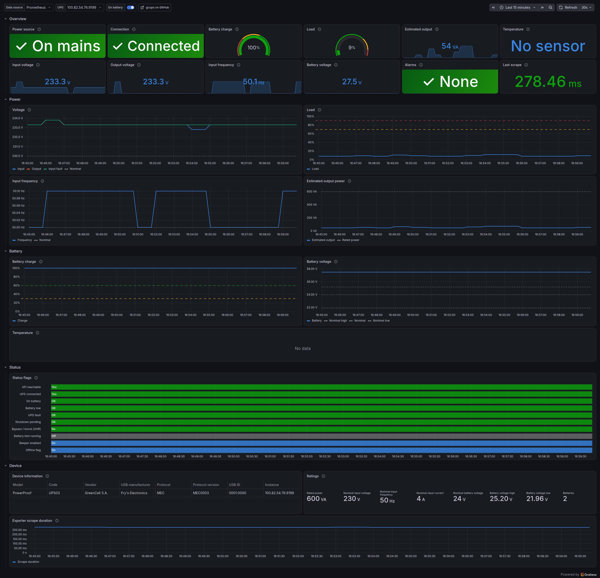

# gcups

The [Green Cell UPS app](https://gcups.greencell.global) (GC UPS) in a container, with its web UI on port 8080 and an optional Prometheus exporter.

The image installs the app with Green Cell's official Linux installer and runs it in its headless service mode: no X server, as an unprivileged user.

> Not affiliated with Green Cell / CSG S.A.

## Quick start

```sh
# 1. Install the app's udev rules on the host, so the container can open the UPS
sudo scripts/install-udev-rules.sh

# 2. Find the UPS device (the udev rules create /dev/ups)
readlink -f /dev/ups   # e.g. /dev/bus/usb/001/010

# 3. Run it
docker run -d --name gcups --restart unless-stopped \
  -p 8080:8080 \
  -e GCUPS_PASSWORD='change-me-123' \
  -v gcups-data:/var/lib/gcups \
  --device "$(readlink -f /dev/ups)" \
  ghcr.io/n1eko/gcups:1.1.10
```

Open `http://<host>:8080` and log in with `GCUPS_PASSWORD`.

**With Compose:** set the device in [`compose.yaml`](compose.yaml), put `GCUPS_PASSWORD=...` in a `.env` file, and run `docker compose up -d`. This also starts the exporter.

## Configuration

| Variable          | Default    | Description |
|-------------------|------------|-------------|
| `GCUPS_PASSWORD`  | `gcups123` | Web UI password, applied on every start. Empty keeps the stored password. **Change it.** |
| `GCUPS_HTTP_PORT` | `8080`     | Web UI port inside the container. |

App data (settings, statistics, schedules) lives in `/var/lib/gcups`. Mount a volume there.

## USB device

The device number changes when the UPS is re-plugged or the host reboots. When that happens, recreate the container with the new path. Use `-e GCUPS_PASSWORD=` to keep the password stored in the volume.

To avoid that, pass the whole USB bus instead of one device:

```sh
docker run ... -v /dev/bus/usb:/dev/bus/usb --device-cgroup-rule='c 189:* rmw' ...
```

## Prometheus exporter

```sh
docker run -d --name gcups-exporter --restart unless-stopped \
  -p 9199:9199 \
  -e GCUPS_URL=http://<gcups-host>:8080 \
  -e GCUPS_PASSWORD='change-me-123' \
  ghcr.io/n1eko/gcups/exporter:latest
```

Metrics are served on `:9199/metrics`:

- `gcups_up`: the app's API could be read.
- `gcups_connected`: the app is talking to the UPS.
- Readings: input/output voltage, input frequency, load, battery level and voltage, temperature (if the model has a sensor), and the device's nominal ratings.
- Status flags: `gcups_utility_fail` (on battery), `gcups_battery_low`, `gcups_failed`, and more.
- `gcups_ups_info`: model and protocol labels.

Load and battery level are ratios from 0 to 1. Readings are only exported while a UPS is connected. Optional settings: `GCUPS_TIMEOUT` (default `5` seconds) and `EXPORTER_PORT` (default `9199`).

**Grafana dashboard:** import [`exporter/grafana/gcups-dashboard.json`](exporter/grafana/gcups-dashboard.json) (Dashboards → New → Import) and pick your Prometheus data source. It shows every exported metric: power and connection status, battery, load, voltages, frequency, status flags over time, and device ratings.



Example alerts:

```yaml
- alert: UpsOnBattery
  expr: gcups_utility_fail == 1
  for: 30s
- alert: UpsBatteryLow
  expr: gcups_battery_low == 1 or gcups_battery_level_ratio < 0.3
- alert: UpsDisconnected
  expr: gcups_up == 0 or gcups_connected == 0
  for: 2m
```

## Troubleshooting

**The container is up but the web UI doesn't respond**, and the logs show `napi_release_threadsafe_function(...): Assertion ... failed`: the UPS is plugged into the host but not passed to the container, usually because its device number changed. Recreate the container with `--device "$(readlink -f /dev/ups)"`.

## Development

| Path | Contents |
|------|----------|
| `gcups/` | App image: installer, entrypoint, web UI setup |
| `exporter/` | Exporter image and its unit tests |
| `scripts/` | udev rules installer, gcups version helpers |
| `tests/smoke.sh` | End-to-end test of both images |

```sh
docker build -t gcups:test gcups && docker build -t gcups-exporter:test exporter
tests/smoke.sh gcups:test gcups-exporter:test                 # no UPS needed
(cd exporter && pip install -r requirements.txt -r requirements-dev.txt && python -m pytest tests)
```

**New gcups versions:** a weekly workflow checks Green Cell's download page, and when there's a newer version it opens a pull request that has already been built and smoke-tested. To bump by hand: `scripts/set-gcups-version.sh "$(scripts/latest-gcups-version.sh)"`.

**New metrics:** add a line to `exporter/gcups_exporter/metrics.py`.

## License

[MIT](LICENSE) for this repository. The GC UPS app installed into the image is Green Cell's proprietary software, under its own license.
